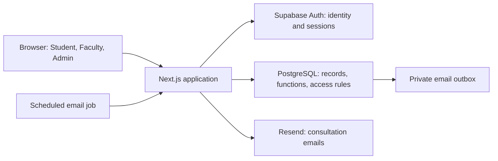
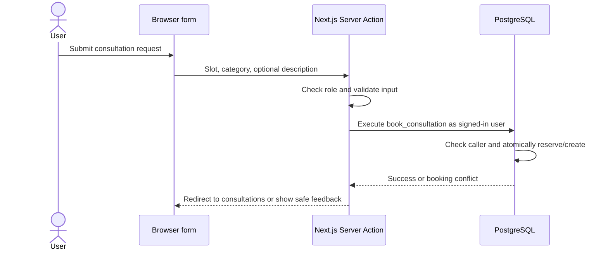

# Architecture

[Documentation guide](../README.md) · Previous: [Business rules](rules.md) · Next: [Database model](data-model.md)

The browser displays the interface. The Next.js application renders pages, processes forms, and checks access. Supabase Auth manages identity; PostgreSQL stores records and enforces booking and data-access rules. Resend delivers optional consultation emails.

## System components

The outbox stores work awaiting delivery. The server reads and updates it; PostgreSQL does not call Resend directly. Supabase Auth sends verification and password-recovery emails through its separately configured email service.

## How a request is handled

For an initial page load, a server-rendered page obtains authorized data from a feature repository and sends the rendered result to the browser. Interactive controls such as calendars, dialogs, and filters run as client components.

For a form submission:

Repositories centralize feature reads. Server Actions and route handlers perform protected writes through the Supabase client or transactional database functions. Client-side list loaders also check access and validate inputs before repository reads. The [API reference](../reference/api.md) distinguishes these entry points and their return behavior.

## Technical terms

| Term               | Meaning in this project                                                              |
| ------------------ | ------------------------------------------------------------------------------------ |
| Authentication     | Establishing who is signed in                                                        |
| Authorization      | Checking what that account may read or change                                        |
| Server Component   | A React component rendered on the server, used for pages and initial data            |
| Client Component   | A component with browser interactions, such as a calendar or dialog                  |
| Server Action      | A Next.js server function invoked by a form or client interaction                    |
| Repository         | Feature code that obtains stored data through Supabase queries or functions          |
| RPC                | Remote procedure call; here, executing a named PostgreSQL function                   |
| RLS                | Row-level security: database rules controlling which rows a caller may access        |
| Atomic transaction | Related database changes succeed together or are rolled back together                |
| Zod                | The validation library that checks submitted fields before they are trusted          |
| Cursor             | Values marking the position after the last loaded record for pagination              |
| Service role       | A privileged server credential used for restricted operations; never a browser value |
| Outbox             | Stored email tasks waiting for delivery or retry                                     |

## Authentication model

Accounts use school email and password with mandatory email verification. The app passes credentials to Supabase Auth; it does not persist plaintext passwords in application tables. Supabase Auth stores password hashes. Email confirmation and password recovery use `/auth/confirm`, which verifies the email token and establishes a cookie-backed session.

The auth-user trigger creates the application profile. The browser cannot self-assign a trusted role or account status. Profile, email verification, and allowed-domain checks determine access. [Business rules](rules.md#sign-in-routing) describes the resulting destinations.

`src/proxy.ts` refreshes the Supabase session cookie on non-static requests. Refreshing a session does not authorize an action.

## Authorization

The application has several independent checks:

1. **Pages and layouts** require the correct role before returning portal data.
2. **Server Actions and read loaders** authenticate and authorize each request rather than trusting the visible UI.
3. **Database functions, grants, constraints, and RLS** enforce data access and valid state changes when persistence is requested.

| Helper                      | Purpose                                                                                                                       |
| --------------------------- | ----------------------------------------------------------------------------------------------------------------------------- |
| `getAuthenticatedProfile()` | Request-memoized lookup of verified identity, profile, and allowed-domain eligibility                                         |
| `requireRole(role)`         | Requires the specified approved role; redirects unauthenticated users to sign-in and mismatched accounts through role routing |
| `authorizeRole(role)`       | Applies access checks with `401`/`403` results for HTTP route handlers                                                        |
| `requireApprovedProfile()`  | Requires an approved account for shared reads/actions, such as its notification inbox                                         |

[RoleLayout](../../src/components/layout/RoleLayout.tsx) protects the role portals. The [auth repository](../../src/features/auth/repositories/authRepository.ts) defines the helpers. Admin pages also apply role checks themselves.

A page can stream a loading shell before redirecting an unauthorized account, so its initial HTTP status is not equivalent to a route-handler permission result. The export endpoint has explicit `401`/`403` responses; see the [API reference](../reference/api.md#http-endpoints).

## Data integrity and privacy

A booking checks and reserves an open slot in the same transaction that creates the pending consultation. Database constraints prevent overlapping faculty availability and more than one active consultation per slot. Concurrent clicks therefore cannot create two active bookings for that slot.

Private descriptions, outcomes, and approved/completed meeting links are participant-facing. Admin application views and exports use metadata and aggregate results. Exact visibility is defined in [Business rules](rules.md#visibility); database grants and result functions are documented in the [database model](data-model.md#rls-and-grants).

User-controlled fields are validated on the server. UI error feedback avoids exposing database/provider details. Browser-visible configuration contains public values only; privileged credentials remain server-side. See [Environment reference](../reference/environment.md).

## Email pipeline

1. Consultation lifecycle functions create in-app notifications and enqueue eligible status email tasks in the private `email_outbox`.
2. Status decision/cancellation actions can attempt delivery after the database operation. Email failure does not roll back a successful consultation decision.
3. The protected scheduled route queues next-day reminders and processes the same outbox.
4. The processor claims up to 25 records with a ten-minute lease. It sends through Resend using each record ID as an idempotency key, then marks it sent or records failure for retry.

An idempotency key allows repeated delivery attempts to identify the same email task. The database's `FOR UPDATE SKIP LOCKED` claim prevents workers from claiming the same unlocked batch concurrently. The [rules](rules.md#notifications-and-email) define retry limits; [Operations](../operations.md#scheduled-email) defines scheduling and configuration.

## Code organization

| Feature directory under `src/features/` | Responsibility                                                 |
| --------------------------------------- | -------------------------------------------------------------- |
| `auth`                                  | Sign-in, recovery, first-admin claim, and access guards        |
| `applications`                          | Approved account directory, faculty promotion, and corrections |
| `admin`                                 | Department management                                          |
| `availability`                          | Faculty schedule actions and reads                             |
| `booking`                               | Faculty discovery, available slots, and Student booking        |
| `consultations`                         | Lifecycle actions, lists, details, and CSV summary formatting  |
| `dashboard`                             | Role-specific summary reads                                    |
| `notifications`                         | In-app inbox and read state                                    |
| `email`                                 | Outbox processing and Resend delivery                          |

Routes live in `src/app/`, shared UI in `src/components/`, common utilities and Supabase clients in `src/lib/`, and executable schema changes in `supabase/migrations/`. The [database model](data-model.md) explains the persisted records.
