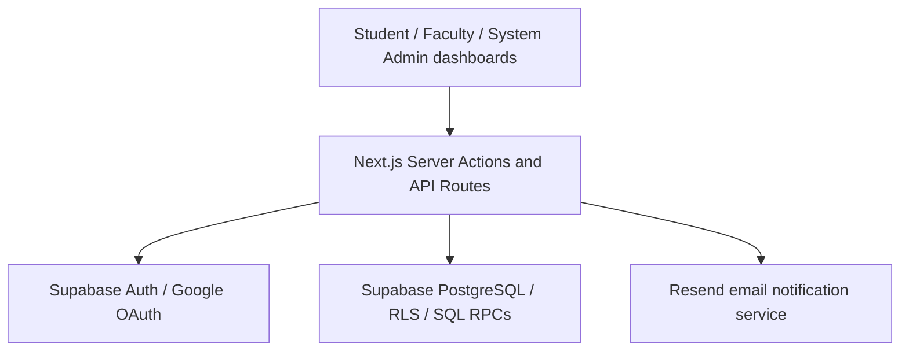

**ASSUMPTION COLLEGE OF DAVAO**

FACULTY CONSULTATION AND  
SCHEDULING SYSTEM

**System Documentation Reference**

Planning and development master reference • Version 0.2 • 11 October 2026

| **Document control**  | **Value**                                                                                    |
|-----------------------|----------------------------------------------------------------------------------------------|
| Status                | Working specification — requirements agreed by the team; application not yet run or verified |
| Prepared for          | IT 305 – Integrative Programming and Technologies \| System Integration Mini-Project         |
| School / setting      | Assumption College of Davao, J.P. Cabaguio, Agdao, Davao City                                |
| Primary evidence      | Data Gathering Report, interviews with Program Head and ICTC Head, 16 September 2026         |
| Development reference | Existing Next.js / Supabase project archive; static code inspection only                     |
| Companion tracker     | ACD_Implementation_Gap_Tracker_v0.2.md — development state and pending tasks                 |

> **HOW TO READ** Sections 1–14 define what the proposed system should do. The companion gap tracker shows what is actually built, incomplete or untested. “Proposed” does not mean approved school policy or working code.

# 1. System Overview & Objectives

## 1.1 System identity

| **Field**      | **Details**                                                               |
|----------------|---------------------------------------------------------------------------|
| System name    | Faculty Consultation and Scheduling System                                |
| Platform       | Responsive web application                                                |
| Institution    | Assumption College of Davao                                               |
| Primary users  | Students, Faculty, System Admin                                           |
| Program Head   | Faculty capabilities; separate departmental reporting permission deferred |
| Target project | IT 305 System Integration Mini-Project                                    |

## 1.2 Purpose

The system will centralize faculty availability, student consultation requests, appointment decisions and consultation records. Students can see available slots and track requests; faculty can manage schedules and preserve consultation history. It is designed to reduce fragmented coordination and repeated paper recording without replacing the school’s Student Information System (SIS).

## 1.3 System objectives

- Allow students to request appropriate available faculty consultation slots online.

- Let faculty review requests and prevent conflicting appointments.

- Preserve completed and walk-in consultations in searchable digital histories.

- Give authorized users timely notifications and role-appropriate access.

- Provide demonstrable API, database CRUD and authentication integrations for IT 305.

# 2. Organization Profile

## 2.1 School setting

Assumption College of Davao is the institution studied. The September 2026 interviews were conducted with the Program Head and the Information and Communications Technology Center (ICTC) Head. The school currently uses posted schedules, institutional email/Google Workspace, SIS for academic reference, consultation slips and visitor logbooks.

## 2.2 Vision and mission

The school’s official vision and mission were not collected in the data-gathering report, so they are not reproduced here. Project vision (proposed): make consultation scheduling easy to access and consultation records easier to preserve. Project mission (proposed): provide secure booking, faculty approval and digital recordkeeping within a manageable student-built web system.

## 2.3 Stakeholders

| **Stakeholder**              | **Interest / responsibility**                                                                 |
|------------------------------|-----------------------------------------------------------------------------------------------|
| Students                     | Find faculty, submit requests, attend consultations, view history and outcome remarks.        |
| Faculty                      | Publish individual slots, decide on requests, conduct consultations and document outcomes.    |
| System Admin                 | Manage approved user accounts, roles and departments; maintain platform configuration.        |
| Program Head / Dean’s Office | Conduct own faculty consultations; possible future departmental records access.               |
| ICTC                         | Existing school identity, infrastructure and SIS authority; no direct SIS connection assumed. |

# 3. Current System & Problems

## 3.1 Current operations (interview findings)

**Present consultation workflow**

> **1.** Student identifies an academic, grade, capstone, personal or other consultation concern.
>
> **2.** Student checks printed/announced faculty availability or uses institutional email.
>
> **3.** Student approaches faculty or office personnel and may need to wait or follow up.
>
> **4.** When required, the visit is entered in a paper logbook and consultation slip (separate records).
>
> **5.** Faculty conducts the consultation; SIS may be viewed separately for grades or prerequisites.
>
> **6.** An outcome may be recorded and physical records retained for future reference.

## 3.2 Identified problems (PIECES summary)

| **Area**    | **Observed problem**                                                        | **Practical impact**                                             |
|-------------|-----------------------------------------------------------------------------|------------------------------------------------------------------|
| Performance | Availability is not confirmed per student and faculty commitments conflict. | Waiting, missed windows and schedule clashes.                    |
| Information | Schedules, email and paper records are separate.                            | Uncertain appointment status and scattered consultation details. |
| Control     | No dedicated booking control for competing requests.                        | Risk of overlapping attempts and unreliable availability.        |
| Efficiency  | Slips and logbooks require repeated handwriting.                            | Additional staff work and manual retrieval.                      |
| Service     | No central request/approval view or timely follow-ups.                      | Students must check multiple communication channels.             |
| Economy     | Storage and manual work create operational effort.                          | No monetary cost estimate was collected.                         |

## 3.3 Evidence boundaries

The interviews did not supply sample official consultation forms, detailed privacy permissions, or a confirmed retention schedule. The reported “approximately three years” was an interview estimate, not an approved digital retention policy. Those items remain to be verified by the school.

# 4. Proposed System

## 4.1 Overview

A school-focused web application with three main roles. Faculty publish individual appointment slots; students request a slot; faculty approve or reject; both participants receive status updates. Faculty document completed or walk-in consultations, with records stored centrally rather than in an individual’s downloaded files.

## 4.2 Core functional modules

| **Module**           | **Main function**               | **Key behavior / rule**                                                                             |
|----------------------|---------------------------------|-----------------------------------------------------------------------------------------------------|
| Authentication       | Google sign-in + access review  | Two approved school email domains; Student/Faculty application; Admin verifies role and department. |
| Faculty directory    | Find the right faculty          | Show same-department faculty first; students may book across departments.                           |
| Availability         | Create/manage bookable slots    | Faculty manually sets date/time, Online/In-person and location; no overlapping slots.               |
| Booking              | Request consultation            | One request reserves one open slot; faculty approves or rejects.                                    |
| Appointment handling | Cancel, reschedule, No-show     | Preserve consultation history; reschedule requires student acceptance.                              |
| Walk-in records      | Document unbooked consultations | Faculty selects registered student or enters unregistered name + department; no student number.     |
| Consultation history | Save/retrieve outcomes          | Outcome remarks optional and visible to the involved registered student.                            |
| Notifications        | In-app + school email           | Status changes and relevant reminders; avoid sensitive remarks in email.                            |

## 4.3 Primary user flows

**Flow A — Online booking**

> **1.** Student signs in with an approved school Google identity and receives an approved Student role.
>
> **2.** Student selects faculty; own-department faculty display first, but all eligible departments remain searchable.
>
> **3.** Student selects an OPEN faculty-created slot, consultation purpose and optional description.
>
> **4.** System reserves the slot and records a PENDING consultation, preventing competing bookings.
>
> **5.** Faculty approves or rejects; approval books the slot, rejection reopens a future slot.
>
> **6.** In ONLINE mode, faculty provides an external meeting link on approval; IN_PERSON uses the location shown for the slot.
>
> **7.** After meeting, faculty marks COMPLETED and may record outcome remarks; history remains accessible to the participants.

**Flow B — Walk-in consultation**

> **1.** Faculty selects an existing registered student, or enters an unregistered student’s name and department.
>
> **2.** Faculty records date/time, reason, outcome when relevant and type WALK_IN.
>
> **3.** System saves the consultation as completed in the faculty history; unregistered students do not receive an app login automatically.

**Flow C — Rescheduling**

> **1.** Faculty proposes a different available slot; the proposed slot is temporarily reserved.
>
> **2.** Student accepts or declines. Acceptance confirms the replacement; decline releases the proposed slot and changes the consultation to Needs Rescheduling.
>
> **3.** Faculty may propose another slot; original request and proposals remain in history.

## 4.4 Essential business rules

| **Rule**              | **Expected system behavior**                                                                                                |
|-----------------------|-----------------------------------------------------------------------------------------------------------------------------|
| Cancellation          | Student may cancel own pending/approved consultation before its start; faculty may cancel assigned consultations.           |
| Slot reopening        | Student cancellation reopens future slots; faculty chooses reopen or block when cancelling.                                 |
| No-show               | Faculty may mark an elapsed appointment NO_SHOW; not counted as completed; record retained.                                 |
| Availability edits    | Only unreserved slots may be edited; pending/approved slots use rescheduling.                                               |
| Modes & locations     | Mode is chosen by faculty per slot; in-person slots use profile default room, overridable per slot.                         |
| Sensitive information | Outcome remarks are student-visible, so the form warns faculty. Limit access to involved users by default.                  |
| Admin privileges      | Applicants cannot self-select Admin; initial Admin is securely provisioned once, not granted solely by .env email matching. |

## 4.5 Scope and limitations

| **Included in target mini-capstone**                | **Outside present scope / deferred**                       |
|-----------------------------------------------------|------------------------------------------------------------|
| Booking, faculty decisions, manual slots, histories | Built-in video calls / automatic Google Meet creation      |
| Two institutional Google domains and role approval  | Direct connection to school SIS without ICTC authorization |
| In-app/email updates, manual walk-ins, No-show      | School-wide PAASCU submission portal                       |
| Faculty own-history export                          | Department-wide Program Head reporting permission          |
| Simple online link and physical room display        | Full chat / capstone file-sharing workflow                 |

> **MIDTERM SCOPE** The full target feature list is not a requirement to finish by Week 4. Midterm needs one working API call used by the app, one complete CRUD flow, and a secure two-role login demonstration.

# 5. Technical Stack & Implementation Mapping

## 5.1 Chosen technologies (existing repository)

| **Layer**      | **Technology**                                  | **Responsibility**                                          |
|----------------|-------------------------------------------------|-------------------------------------------------------------|
| UI             | Next.js 16 / React 19 / TypeScript / Tailwind 4 | Pages, role dashboards, responsive controls.                |
| Server         | Next.js Server Actions and API Routes           | Input validation and server-side workflows.                 |
| Database       | Supabase PostgreSQL, SQL RPC, RLS               | Profiles, departments, slots, consultations, notifications. |
| Authentication | Supabase Auth + Google OAuth                    | School Google account identity and sessions.                |
| Validation     | Zod                                             | Request form and API payload checks.                        |
| Email          | Resend                                          | Important email notifications (not yet live-tested).        |
| Testing        | Vitest / Playwright / Supabase SQL tests        | Unit, end-to-end and database checks.                       |

## 5.2 Key integration points

| **From → To**             | **Method**                                | **Purpose**                                                |
|---------------------------|-------------------------------------------|------------------------------------------------------------|
| Browser → Next.js server  | Server Actions / HTTP API                 | Apply, request booking, read response and update UI.       |
| Next.js → Supabase Auth   | Supabase SDK, OAuth                       | Google sign-in and session verification.                   |
| Next.js → PostgreSQL      | Supabase client / parameterized RPC calls | Persist and retrieve authorized records.                   |
| Next.js → Email provider  | Server-only Resend API                    | Email events and delivery processing.                      |
| SIS → consultation system | No integration planned                    | SIS remains separate and is opened by faculty when needed. |

## 5.3 Week 2 API demonstration

Recommended proof: a session-checked GET /api/faculty/\[facultyId\]/availability endpoint that returns available faculty-created slots, with the booking UI visibly using the JSON response. The route is a proposed addition; current code provides booking data through other server mechanisms and a basic /api/health endpoint. Validate request, response, HTTP status and user access in DevTools/Postman.

## 5.4 Environment and configuration

Keep the two approved institutional domains and the designated initial Admin email in server-side environment configuration. Never expose service-role keys or email credentials in browser variables or shared documents. The first Admin role must be assigned once by a protected bootstrap process after verified sign-in. A domain check alone is not an Admin permission.

# 6. Conceptual Data Model (ERD)

## 6.1 Primary entities

| **Entity**         | **Purpose / relationship**                                                                          |
|--------------------|-----------------------------------------------------------------------------------------------------|
| DEPARTMENTS        | A department may have many users; each approved user is associated with the appropriate department. |
| PROFILES           | Supabase-linked user identity, role, department and account-approval state.                         |
| FACULTY_PROFILES   | Faculty-specific settings; one record per faculty user.                                             |
| AVAILABILITY_SLOTS | Faculty-created date, time, consultation mode, location and slot state.                             |
| CONSULTATIONS      | Connects the faculty, student (when registered), booking slot and consultation outcome.             |
| NOTIFICATIONS      | In-app messages attached to the receiving user.                                                     |
| EMAIL_OUTBOX       | Server-side queued email delivery records (exists in migration code).                               |

## 6.2 Key relationships

- DEPARTMENTS (1) → (many) PROFILES via department_id.

- PROFILES (1) → (0/1) FACULTY_PROFILES for faculty accounts.

- PROFILES as faculty (1) → (many) AVAILABILITY_SLOTS.

- AVAILABILITY_SLOTS (1) → associated consultation booking within defined rules.

- PROFILES (student/faculty) (1) → (many) authorized CONSULTATIONS.

- PROFILES (1) → (many) NOTIFICATIONS.

## 6.3 Planned data extensions (not yet implemented)

| **Need**                     | **Design direction**                                                                                            |
|------------------------------|-----------------------------------------------------------------------------------------------------------------|
| Walk-in unregistered student | Record type BOOKED/WALK_IN; manual student name and department; nullable account link only with safe migration. |
| No-show / reschedule         | Add new status(s) and record proposal history with reservation protections.                                     |
| Default room                 | Add faculty default location; retain slot-specific override.                                                    |
| Institutional email rule     | Server allowlist and approval-time validation independent of editable profile fields.                           |
| Faculty history export       | Authorized, faculty-scoped query; no broad record disclosure.                                                   |

> **DATA DICTIONARY** Existing schema uses UUID internal IDs. An official student-number field is NOT planned. Final field names, nullable constraints and migrations must be checked against the actual code before implementation.

# 7. Design Requirements

## 7.1 Interface direction

Professional school-facing interface: simple navigation, responsive tables/cards, readable forms and obvious booking status. Reuse existing UI components wherever practical; avoid introducing unrelated designs during bug fixes.

## 7.2 Existing application palette (from globals.css)

| **Role**   | **Hex**  | **Usage**                                       |
|------------|----------|-------------------------------------------------|
| Primary    | \#062E61 | Major headings, navigation and primary elements |
| Accent     | \#1769E8 | Links and selected actions                      |
| Background | \#F6F8FC | Page backdrop                                   |
| Surface    | \#FFFFFF | Cards and forms                                 |
| Text       | \#0F1F3A | Primary content                                 |
| Success    | \#176D42 | Success state                                   |

> **DESIGN NOTE** The green headings in this Word document follow the BloomBites reference style. They do not change the existing blue application theme.

## 7.3 Pages and main navigation

| **Student**             | **Faculty**                             | **System Admin**            |
|-------------------------|-----------------------------------------|-----------------------------|
| Dashboard / Directory   | Dashboard / Availability                | Dashboard / Applications    |
| Book / My Consultations | Requests / Consultations                | Users / Departments         |
| History / Notifications | History / Walk-ins (planned)            | Faculty directory / Summary |
| Account status          | Default consultation location (planned) | System settings as needed   |

## 7.4 Usability principles

- Explain disabled slots and pending approvals clearly.

- Show consultation mode, date/time and room or meeting link before the appointment.

- On small screens, forms and tables must remain readable without horizontal content overlap.

- Warn faculty that outcome remarks are visible to the student.

- Use accessible labels, focus indicators and confirmation before cancellation.

# 8. Non-Functional Requirements

| **Requirement** | **Specification / verification**                                                                                         |
|-----------------|--------------------------------------------------------------------------------------------------------------------------|
| Security        | All privileged operations require server checks and database RLS; institutional-domain allowlist; no self-granted Admin. |
| Data accuracy   | No overlapping faculty slots and no double-booking under simultaneous requests.                                          |
| Privacy         | Only the concerned student and assigned faculty see consultation details by default; limit email content.                |
| Reliability     | Booking and availability state change together or fail together; preserve cancelled/no-show history.                     |
| Usability       | Forms describe states and validation errors; keyboard focus and mobile layouts are usable.                               |
| Performance     | Response-time targets will be established after a runnable baseline and instructor acceptance criteria.                  |
| Retention       | Institutional policy must confirm exact retention and deletion/retrieval rules.                                          |
| Maintainability | TypeScript typing, documented migrations, repository tests and reproducible setup.                                       |

# 9. Project Objectives (SMART)

## 9.1 General objective

To design and implement a web-based Faculty Consultation and Scheduling System for Assumption College of Davao that improves appointment coordination and digital consultation documentation.

## 9.2 Verifiable project objectives

- By the IT 305 midterm, demonstrate one successful application-consumed API request with saved request/response evidence.

- By the IT 305 midterm, demonstrate Create, Read, Update and Delete against one faculty availability resource, with database before/after evidence.

- By the IT 305 midterm, demonstrate Google sign-in and two restricted roles, including a blocked unauthorized page.

- By mini-capstone completion, demonstrate a complete student request → faculty decision → consultation record lifecycle.

- By mini-capstone completion, demonstrate faculty walk-in recording, history search/export and major notification events.

> **MEASUREMENT** Deadlines and numeric performance targets should follow the instructor’s published schedule. Do not claim an observed time reduction before comparative testing.

## 9.3 Scope of automation

| **Process**                    | **Automation level**           | **Remaining human action**                                          |
|--------------------------------|--------------------------------|---------------------------------------------------------------------|
| Account identity               | Partial                        | Google authenticates; Admin verifies applicant role and department. |
| Slot booking / conflict checks | Full for supported rules       | Faculty publishes available slots.                                  |
| Appointment approval           | Partial                        | Faculty accepts/rejects.                                            |
| Consultation completion        | Partial                        | Faculty conducts meeting and marks completion.                      |
| Notifications                  | Automated on configured events | Faculty/student respond to updates.                                 |
| Report export                  | Automated retrieval            | Authorized faculty chooses filters and downloads file.              |

# 10. Success Criteria

The proposed system is ready for final demonstration when the following observable checks pass:

- Students can find faculty and submit requests for OPEN slots without duplicate reservations.

- Faculty approves or rejects; correct status and slot behavior is saved.

- Both students and faculty see authorized histories, including optional student-visible outcomes.

- Walk-in, No-show, cancellation and reschedule states follow agreed rules and preserve history.

- Only approved institutional users enter protected role dashboards; unauthorized access is blocked.

- At least one application-used API call and complete database CRUD flow have reproducible evidence.

- Key routes, database constraints, notifications and role boundaries pass agreed tests.

# 11. Important Notes for Developers

## 11.1 How to use these documents

Read this master document to understand the target behavior. Open the separate implementation gap tracker to identify what is present, incomplete or untested. Inspect the real source before editing, then update the tracker with the exact tests and commit that prove the change. Revise this master only when an agreed requirement changes.

## 11.2 Development guardrails

- Preserve the existing Next.js/Supabase architecture; do not add parallel booking controllers or duplicate authentication layers.

- Use server-validated parameters, ownership checks, PostgreSQL policies and atomic reservation logic.

- Never embed personal student records, API keys or service tokens in repo documentation, screenshots or email notifications.

- Treat the report’s recommendation for SIS integration as explicitly deferred until ICTC approval.

- Do not claim “working” until the action is run and verified with realistic test users.

- Record AI assistance honestly with dated prompt evidence and authentic Git commit hashes.

## 11.3 School/instructor confirmations still pending

Actual approved email domains; approved initial Admin identity; official consultation slip/logbook content and retention rules; unanswered rescheduling-proposal expiration; and OAuth evidence substitution for the midterm password-hashing screenshot.

# 12. User Roles & Permissions

## 12.1 Role responsibilities

| **Role**              | **Permitted responsibilities**                                                                                        |
|-----------------------|-----------------------------------------------------------------------------------------------------------------------|
| Student               | Submit consultation request; cancel own future request; respond to reschedules; read own history and remarks.         |
| Faculty               | Manage own availability; approve/reject assigned requests; record walk-ins, outcomes and No-show; export own history. |
| System Admin          | Review applications, correct department/role within policy, manage departments and authorized system users.           |
| Program Head (future) | Faculty functionality plus separately authorized department reports, NOT an automatic Admin role.                     |

## 12.2 Permission highlights

| **Action**                 | **Student**      | **Faculty**   | **Admin**      |
|----------------------------|------------------|---------------|----------------|
| Request appointment        | Own only         | —             | —              |
| Create/edit open slots     | —                | Own only      | —              |
| Approve consultation       | —                | Assigned only | —              |
| Mark completed/No-show     | —                | Assigned only | —              |
| Read outcome notes         | Own consultation | Assigned only | Not by default |
| Manage user approvals      | —                | —             | Authorized     |
| Export own faculty history | —                | Own only      | Not by default |

> **PRIVACY** A System Admin’s technical responsibilities do not automatically justify access to confidential outcome notes. Department reporting is deferred pending a role-specific school policy.

# 13. System Architecture & Development Standards

## 13.1 High-level architecture

Logical architecture, not a screenshot: React pages call Next.js server functions/API routes; server code validates identity and accesses Supabase; scheduled email delivery uses a server-side provider. The school SIS has no direct connection.

**Architecture overview (text version for AI-assisted development):**

The existing school SIS is separate. This is a logical architecture diagram, not an implementation verification.

## 13.2 Primary data flows

**Example — consultation request**

> **1.** Student UI requests faculty availability from an authenticated server endpoint.
>
> **2.** Next.js server verifies session, approved role and input; Supabase reads eligible slots.
>
> **3.** Booking RPC creates the pending consultation and reserves the slot atomically.
>
> **4.** Faculty accepts or rejects; SQL state and notifications change consistently.
>
> **5.** Student and faculty read their authorized appointment details and history.

## 13.3 Repository and deployment conventions

Keep features under existing src/features and routes under src/app. Place schema changes in versioned supabase/migrations, regenerate database types after migration, run npm run check and targeted Playwright tests, and document deployment environment variables by name only. The final hosting platform is TBD; do not claim production deployment.

# 14. Testing & Quality Assurance

## 14.1 Test approach

| **Test area**  | **What to demonstrate**                                                             |
|----------------|-------------------------------------------------------------------------------------|
| Unit/component | Validation functions and status buttons accept correct and reject invalid input.    |
| Integration    | API response changes UI; RPC updates database; notification events are recorded.    |
| Security       | Gmail cannot apply; authorized domain can apply; Student cannot access Admin route. |
| Concurrency    | Two simultaneous attempts cannot book one slot twice.                               |
| End-to-end     | Student booking → Faculty approval → Completed history; walk-in recording.          |
| Usability      | Main role screens and forms work at mobile/tablet/desktop sizes.                    |

## 14.2 Minimum acceptance scenarios

| **ID** | **Scenario**                         | **Expected result**                                         |
|--------|--------------------------------------|-------------------------------------------------------------|
| TC-01  | Approved Student books OPEN slot     | Creates one PENDING record and reserves one slot.           |
| TC-02  | Faculty approves ONLINE request      | Confirms appointment and safely shares manual meeting link. |
| TC-03  | Faculty edits BOOKED slot directly   | Denied; rescheduling required.                              |
| TC-04  | Student cancels future request       | History preserved; future slot reopens.                     |
| TC-05  | Faculty records unregistered walk-in | Stores completed record without student account/number.     |
| TC-06  | Student attempts Admin page          | Access denied; no protected data returned.                  |
| TC-07  | Outsider Gmail attempts application  | Rejected before application; cannot be approved.            |
| TC-08  | No-show after appointment ends       | History preserved and completed count unchanged.            |

## 14.3 Midterm evidence checklist

Demonstrate updated architecture/data flows, setup steps, a real API request/response used by the app, database CRUD before-and-after records, login and role denial, member Git history, an unedited 3–5 minute demonstration, individual code walkthroughs, and signed AI declarations with genuine dated evidence. These items belong to the separate midterm submission package.

> **TEST STATUS** No application runtime verification was performed while preparing this reference. Test cases are specifications, not passing results.
